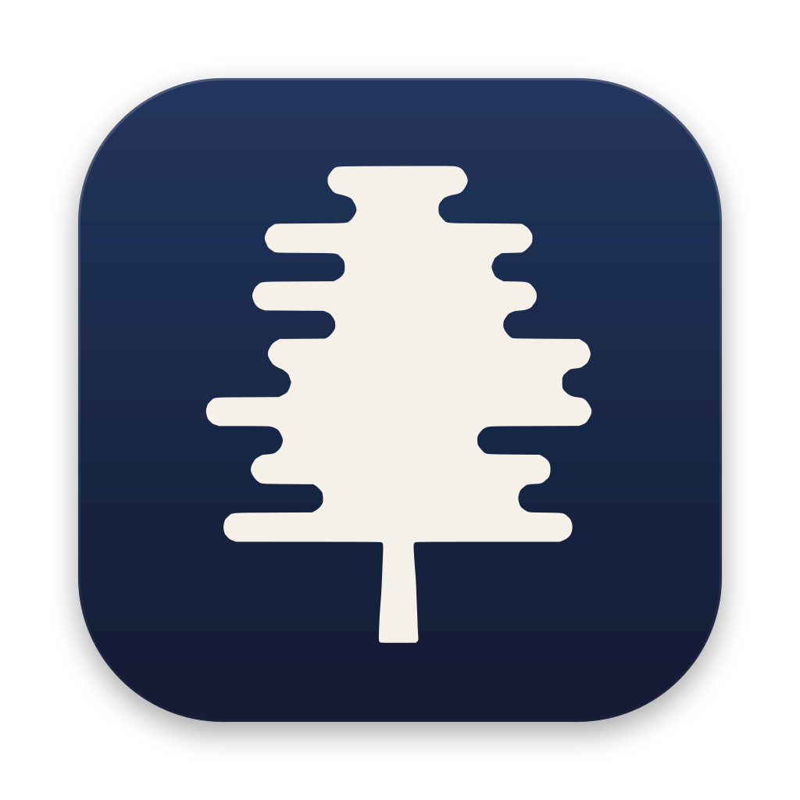

# Tonkori DAW

A personal DAW for the Tonkori studio rig. It is not a commercial product.

**Get the app:** open the [latest release](../../releases/latest), download the `.zip` and unzip it. Move **Tonkori DAW** to Applications and open it. The first time, macOS may block it: go to **System Settings → Privacy & Security** and click **Open Anyway**.

Target: Mac Studio (Apple M1 Max), macOS 13.7.1 (Ventura) and later, Apple Silicon only.

## Thesis

One object model, several views. Every capability comes from a mechanism borrowed from one of five DAWs:

| From | Mechanism | Layer |
|---|---|---|
| Reaper | One uniform track type; any routing; every action scriptable | Spine |
| Pyramix | High-rate engine (to DXD), source–destination editing, immersive buses | Engine |
| Pro Tools | Edit grammar: Shuffle/Slip/Spot/Grid, playlists and comping | Editing |
| Ableton Live | Clip launcher as a second view of the same clips; warp | View |
| RipX | Audio decomposed into editable note objects | Data |

The new idea is **transparent-until-touched decomposition**. The original PCM is always the source of truth. Note objects are a derived layer. The render rule is:

    output = original − (original versions of edited notes) + (resynthesized edited notes)

Untouched audio stays bit-identical, so null tests pass. Artifacts can only appear where something was actually edited.

## Engine: the Pyramix profile

Pyramix processes in 32-bit floating point. MassCore is Merging's Windows real-time scheduler, not a different "sound". On macOS, Tonkori matches the engine's behaviour:

- **32-bit float** processing end to end, the same format as Pyramix.
- **Recording** as 32-bit float WAV at the device rate, up to 384 kHz / DXD. Takes go in `<Session> Audio/`.
- **Real-time threads joined to Core Audio's audio workgroup** (macOS's mechanism for scheduling helper threads against the device deadline on performance cores), using a spin-based real-time thread pool. This is the counterpart of MassCore's dedicated cores.
- **Unity path:** master at 0 dB (Tracktion defaults to −3 dB), linear pan law (0 dB at centre), no automatic clip fades. An untouched clip renders **bit-identical**.
- **DSD:** DSF and DSDIFF (DSD64/128/256) import as DXD (352.8 kHz float), the way Pyramix edits DSD. The decoder uses a 48·D-tap Kaiser FIR (≈120 dB stop band, −6 dB at 148 kHz). Group delay is compensated so the decoded audio lines up with the DSD sample-accurately. 100% modulation maps to ±1.0, so SACD 0 dB sits at −6 dBFS.
- **RAVENNA / AES67:** on a Mac this goes through Merging's Virtual Audio Device. Tonkori sees it as a Core Audio device, up to DXD and DSD256 rates.
- **Export:** WAV 32-bit float, or 24/16-bit with TPDF dither.

Two small engine patches live in `patches/`. The first lets each clip supply its own fade length and curve table to the engine's fade node. The second applies the clip gain line in the same node and switches Rubber Band time stretching to its R3 (finer) engine.

`tests/EngineSelfTest.cpp` proves these claims on every build. Its results ship with each release as `selftest.txt`.

## Shortcuts

Four sets: Ableton Live (the default), Pro Tools, Logic Pro and Pyramix. Switch in **File → Shortcut Set** or **Settings → Shortcuts**, where every key can also be changed. See [docs/SHORTCUTS.md](docs/SHORTCUTS.md).

## Video

**File → Import Video** takes MOV, MP4, M4V, MXF, AVI, MKV and WebM (ProRes, DNxHD/HR, H.264, HEVC, MPEG-2, DV, Motion JPEG and others). The video gets its own track with thumbnails above the audio tracks and a separate video window. Its audio can come in as a clip. The picture is shown at the playhead minus the output latency and minus a sync offset you set in **Settings → Latency & sync**.

**File → Export Video** writes ProRes (Proxy, LT, 422, HQ, 4444) or DNxHR (LB, SQ, HQ, HQX, 444) in MOV or MXF with 24- or 32-bit PCM. It can also write H.264 or HEVC through the Mac's hardware encoder, or copy the original picture untouched and replace only the sound. Timecode is written into the file. Decoding and encoding use a static LGPL build of FFmpeg pinned in `deps.lock`.

## Audio interfaces (RME MADI and others)

Inputs open as mono channels, so a MADIface shows 64 separate inputs (switchable to stereo pairs in **Settings → Audio**). **Settings → Latency & sync** shows what the driver reports (device, safety offset, buffer), the plug-in delay, and a loopback measurement: patch an output to an input with a cable (or TotalMix loopback) and click Measure. Recordings are shifted automatically by the reported latency plus any extra offset found there.

## Milestones

- **M0, walking skeleton** (build 1): arrangement, transport, recording, audio import, AU/VST3 hosting, device settings, session save/load.
- **M0.2** (build 2): Ableton Live 12 key map and menu bar, Pyramix-profile engine, DSD→DXD import, audio export, engine self-test.
- **M1, Edit window** (build 3): new interface (transport/tool bars, ruler, track headers, waveform canvas, Inspector, Mixer); Smart Tool, tools and edit modes; time selections; numeric, programmable fades with live on/off and session auto-fades; crossfades from a selection; Spot; Finder drag-and-drop. All of it works while playing or recording. See [docs/FEATURE-MAP.md](docs/FEATURE-MAP.md).
- **M2, recording and comping** (build 4): take lanes and comping, pre/post-roll, count-in, crossfade editor with splice offset, clip gain line, time stretch and pitch, sends and buses, markers, stem export, LUFS and true-peak metering, video import and export, four shortcut sets, settings window with latency measurement, out-of-process plug-in scanning.
- **M2.5:** 3- and 4-point source–destination editing (Pyramix).
- **M3, launcher:** clip-grid view on the same clips.
- **M4, decomposition:** stem separation, note objects, the transparent render rule.
- **M5, scripting:** action list and a script console.
- **M6, delivery:** ADM/immersive buses, DDP, stem delivery, AAF.

## Build

Fully automated: every push to `main` builds on GitHub's Apple Silicon machines (see `.github/workflows/build-macos.yml`) and publishes a release.

The app icon and toolbar mark are the Tree Mountain Studios tree.

Built on [Tracktion Engine](https://github.com/Tracktion/tracktion_engine) (GPLv3) and [JUCE](https://juce.com) (AGPLv3), pinned in `deps.lock`, with [Rubber Band](https://breakfastquay.com/rubberband/) (GPL) for time stretching and [FFmpeg](https://ffmpeg.org) (LGPL build) for video. `src/vendor/tracktion_examples` holds Tracktion's example UI code (GPLv3). It serves as the M0 arrangement view and will be replaced.
